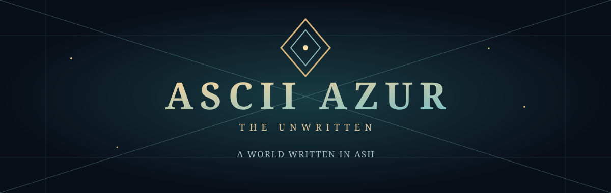
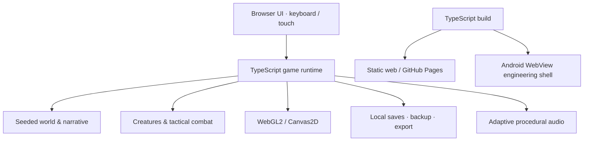

<div align="center">

<a href="https://akumanomi1988.github.io/ASCII_AZUR/"></a>

# ASCII AZUR
### THE UNWRITTEN

**A world written in ash. A story held together by what you remember.**

A dark-fantasy creature-bonding RPG set in a persistent, procedurally generated world of atmospheric glyphs.

[**Play in your browser**](https://akumanomi1988.github.io/ASCII_AZUR/) · [Explore the world](#the-world) · [Get started](#run-locally) · [Architecture](docs/ARCHITECTURE.md)

<sub>v0.70.1 · Browser-first distribution · Android engineering candidate</sub>

</div>

---

[](https://github.com/akumanomi1988/ASCII_AZUR/stargazers) [](https://github.com/akumanomi1988/ASCII_AZUR/network/members) [](https://github.com/akumanomi1988/ASCII_AZUR/commits/main)

## A world that remembers

Names are disappearing from Azur. Explore forgotten roads, form bonds with creatures, recover memories and decide what deserves to survive.

ASCII AZUR combines authored dark-fantasy storytelling with seeded exploration, tactical encounters and persistent consequences. The world is rendered with WebGL2 and a Canvas2D fallback; its visual language blends atmospheric ASCII with glyph-based pixel composition.

> **Development status:** Playable and actively developed. The authored main-story finale exists, but final art, broad player testing, mobile performance acceptance and commercial-release polish are **not complete**. This is not advertised as a finished AAA release.

## Discover Azur

| **Explore** | **Bond** | **Remember** |
| :--- | :--- | :--- |
| Traverse persistent seeded regions, uncover landmarks and follow a fog-aware Atlas. | Challenge wild creatures, assess elemental tactics, capture allies and develop their techniques. | Follow authored chapters, meet witnesses and make permanent story decisions. |
| **Navigate** | **Prepare** | **Continue** |
| Follow contextual mission guidance and visit previously discovered Lumbres. | Manage a party, relic equipment, healing and four active techniques per creature. | Maintain three independent journeys with local save recovery and import/export. |

## The world

The journey begins in **Arken**, then expands through interconnected regions, crypts and chapter-gated destinations. Exploration reveals landmarks and routes rather than exposing undiscovered areas. The story includes the Marsh and Crown chapters and their branching conclusion; optional regional paths and later recognitions add consequences to completed journeys.

**Core systems implemented**

- **Creature bonds:** sightings, habitat clues, capture, evolutions, party and reserve management, collection milestones and tactical field-hunt preparation.
- **Turn-based combat:** elemental matchups, damage previews, defensive responses, statuses, healing, active technique selection and combat relics.
- **Persistent exploration:** deterministic world seeds, authored landmarks, discoverable routes, chapter gates and a physical eight-chamber crypt.
- **Narrative continuity:** journal, mission compass, irreversible decisions, four ending combinations and post-story recognitions.
- **Accessibility and controls:** keyboard navigation, screen-reader status updates, high-contrast options, touch controls and landscape-oriented mobile UI.
- **Offline-minded saves:** three independent local campaigns, backup recovery, export/import and a standalone HTML build.

<details>
<summary><strong>What changed in v0.70.1?</strong></summary>

Battles now stage anticipation, impact, a double creature reaction and gradual health-bar damage, with spatial keyboard navigation and an animated bond-colored focus cursor that traces continuous light between controls without replacing the text-editing caret. New journeys retain their skippable two-minute cinematic prologue. The Field Hunt flow continues to connect biome-aware wild encounters with tactical briefings, starting-ally selection, Codex research and capture progress. Early chapter travel does not reveal later creatures prematurely.

Read the [v0.70.1 release notes](docs/RELEASE_v0.70.1.md) for precise behavior and validation boundaries.

</details>

## Experience & controls

| Action | Keyboard | Touch |
| :--- | :--- | :--- |
| Move | WASD / arrow keys | On-screen joystick |
| Interact | E | Action button |
| Advance dialogue | Space / Enter | On-screen controls |
| Party | T | Menu |
| Bag | B | Menu |
| Back | Escape | On-screen navigation |

The browser build runs without an account. Game progress is stored locally; export your journey to keep a portable backup.

## Under the hood



| Layer | Implementation |
| :--- | :--- |
| Language | TypeScript 5.8.3 |
| Rendering | WebGL2 with Canvas2D fallback |
| Game & tests | Browser runtime, Node.js built-in test runner |
| Distribution | Static GitHub Pages and generated standalone HTML |
| Android | Offline-capable native WebView shell; **not** a signed store release |
| Persistence | Local save format v1 with recovery and import/export |

For module boundaries and technical debt, see [Architecture](docs/ARCHITECTURE.md). For Android build requirements and emulator evidence, see [Android documentation](android/README.md).

## Run locally

**Requirements:** Node.js 22, npm, Python 3 for verification/release scripts.

```bash
git clone https://github.com/akumanomi1988/ASCII_AZUR.git
cd ASCII_AZUR
npm ci
npm run build
npm run serve
```

Open **http://localhost:8080**.

| Command | Purpose |
| :--- | :--- |
| `npm run build` | Compile TypeScript to `dist/` |
| `npm test` | Run Node.js tests against compiled output |
| `npm run verify` | Build, score assets, standalone HTML, tests and release checks |
| `npm run release` | Verify and generate release artifacts |
| `npm run serve` | Serve the local game on port 8080 |

`src/` is the source of truth. `play.html` is generated and must **not** be edited by hand. The static web distribution uses compiled modules; release automation produces the standalone file.

## Release readiness

| Area | Current state |
| :--- | :--- |
| Main story and branching finale | Implemented |
| Tactical combat, collection and persistent saves | Implemented |
| Browser distribution | Available |
| Android native shell | Engineering candidate; emulator CI described in Android docs |
| Physical Android device acceptance | Pending |
| Independent visual, audio and accessibility acceptance | Pending |
| Final production art, balance and broad playtesting | Pending |
| Signed Android store release | Not available |

Automated tests and emulator checks are engineering evidence, **not** substitutes for physical-device or human playtesting.

<details>
<summary><strong>Technical documentation and release history</strong></summary>

- [Architecture and code ownership](docs/ARCHITECTURE.md)
- [Latest release: v0.70.1](docs/RELEASE_v0.69.1.md)
- [Android shell and build instructions](android/README.md)
- [Release documentation directory](docs/)
- [GitHub commit history](https://github.com/akumanomi1988/ASCII_AZUR/commits/main) — previous README revisions preserve the detailed historical changelog.

</details>

---

<div align="center">

### Some names deserve to be remembered.

[**Enter Azur**](https://akumanomi1988.github.io/ASCII_AZUR/) · [Source code](https://github.com/akumanomi1988/ASCII_AZUR) · [Report an issue](https://github.com/akumanomi1988/ASCII_AZUR/issues)

<sub>ASCII AZUR · Original concept · © 2026</sub>

</div>
